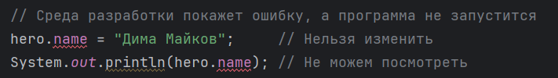
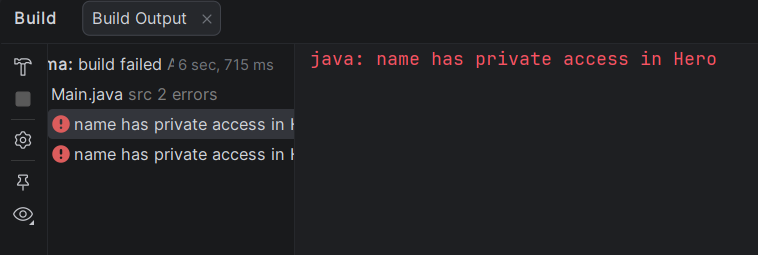
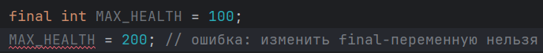
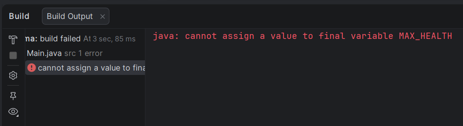
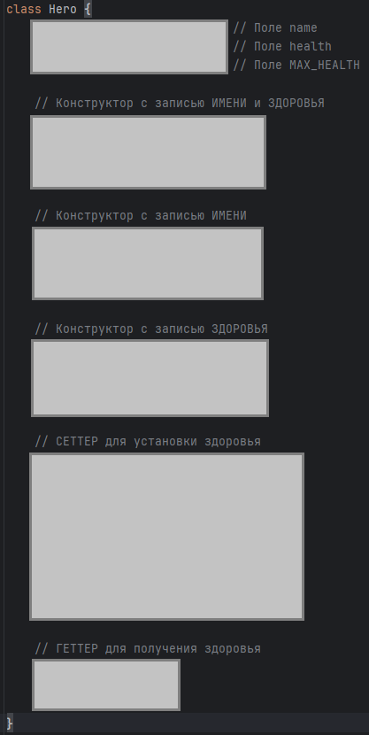
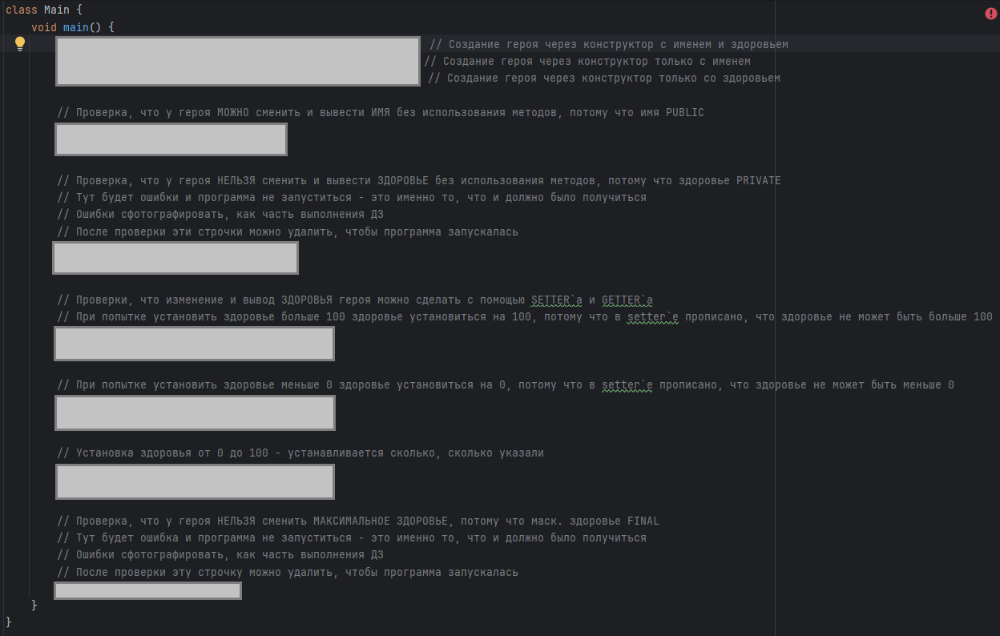

# Домашнее задание N9 (с 08.11.26 до 15.11.26)

---

## Легенда

В домашних заданиях будут использоваться некоторые обозначения:

- **⁉️ Памятка.** В разделах с пометкой "Памятка" будут описаны теоретическая и практическая информация, пройденная на занятиях и необходимая для выполнения домашнего задания
- **✅ Задание.** Раздел, отмеченный, как "Задание", описывается основное домашнее задание, которое необходимо выполнить
- **📚 Что-то новое.** Здесь будет дополнительная информация, которая может быть полезна, или которую мы еще не прошли
- **💡 Подсказка**. В таких разделах будет подмечено, что еще можно добавить в программу или как решить правильно решать задание
- **🏁 Пример.** В таком разделе будет пример выполнения основного задания, а также результат вывода в консоль
- **⭐ Задание со звёздочкой.** Дополнительное задание повышенной сложности - необязательное, но для тех, кто хочет попробовать разобраться в чём-то новом и интересном

---

## Тема ДЗ: Перегрузка, модификаторы private и public, геттеры и сеттеры, final

---

## ⁉️ Перегрузка

**Перегрузка** - это несколько методов (или конструкторов) с **одинаковым именем**, но с **разными параметрами**.
Когда мы вызываем метод, Java сама выбирает нужный вариант по тому, какие аргументы мы передали.

```java
public void heal() {            // лечит на 10 - параметров нет
    health += 10;
}

public void heal(int amount) {  // лечит на amount - один параметр
    health += amount;
}

hero.

heal();      // вызовется первый вариант
hero.

heal(25);    // вызовется второй вариант
```

**Важно запомнить:**

- Методы с одним именем должны отличаться **количеством**, **типами** параметров или **последовательностью типов**
  параметров
- Одинаковые параметры и разные типы результата (`void` и `int`) - это **не** перегрузка, Java выдаст ошибку
- Разные названия параметров методов - тоже **не** перегрузка, Java выдаст ошибку
- Так же можно перегружать **конструкторы**: что мы и рассматривали на занятии:

```java
Hero(int hp, int dmg, String name) {...} // 1 Вариант

Hero(String name, int hp, int dmg) {...} // 2 Вариант

Hero(int hp, String name, int dmg) {...} // 3 Вариант

Hero(String name) {...}                  // 4 Вариант

Hero(int hp) {...}                       // 5 Вариант
```

```java
Hero h1 = new Hero(100, 20, "Дима Майков"); // 1 Вариант 
Hero h2 = new Hero("Дима Майков", 100, 20); // 2 Вариант
Hero h3 = new Hero(100, "Дима Майков", 20); // 3 Вариант
Hero h4 = new Hero("Дима Майков");          // 4 Вариант
Hero h5 = new Hero(100);                    // 5 Вариант
```

| Вариант  | Типы параметров      |
|----------|----------------------|
| 1 Вариант | `int` `int` `String` |
| 2 Вариант | `String` `int` `int` |
| 3 Вариант | `int` `String` `int` |
| 4 Вариант | `String`             |
| 5 Вариант | `int`                |

**В чем отличия:**

- 1, 2 и 3 варианты имеют **одинаковое количество параметров**, но у них **разная последовательность типов**: в 1-ом:
  тип `String` стоит третьим, во 2-ом - первым, в 3-ем - вторым
- У 4 и 5 вариантов **один параметр**, а у 1, 2 и 3 - **три параметра**. Это **разное количество параметров**
- 4 вариант отличается от 5, тем что у них **разные типы**

**На занятии возник вопрос:**

```- У нас уже есть конструктор, принимающий здоровье:```

```Java
Hero(int hp) {
    this.hp = hp;
}
```

`- Почему нельзя создать конструктор, который принимает урон?`

```Java
Hero(int dmg) {
    this.dmg = dmg;
}
```

`- Названия параметров же отличаются`

Обращаем внимание **НЕ** на название параметров, а именно на **их ТИПЫ**:

- У первого метода один параметр типа `int`
- У второго - тоже один параметр типа `int`

Итого:

- Количество совпадает? - Да. Нужно проверить типы
- Типы совпадают? - Да. В таком случае второй метод создать нельзя

---

## ⁉️ Модификаторы public и private

Модификатор доступа пишется в самом начале объявления поля и определяет, **кто может им пользоваться**:

| Модификатор | Где виден                   |
|-------------|-----------------------------|
| `public`    | везде, из любого класса     |
| `private`   | только внутри своего класса |

```java
class Hero {
    public int health;   // снаружи поле ВИДНО и его МОЖНО изменить
    private String name; // снаружи поле НЕ ВИДНО и его НЕЛЬЗЯ изменить
}

class Main {
    void main() {
        Hero hero = new Hero();

        hero.health = 10;                // Можем изменить
        System.out.println(hero.health); // Можем посмотреть

        // Среда разработки покажет ошибку, а программа не запустится
        hero.name = "Дима Майков";     // Нельзя изменить
        System.out.println(hero.name); // Не можем посмотреть
    }
}
```

Подсказка от среды разработки:



Ошибка запуска программы:



---

📚 **Что-то новое**

```text
Модификаторы доступа private и public можно применять не только к полям класса, но и к его методам.

Например, метод private можно вызвать только внутри самого класса - он «спрятан» от других.
А метод public доступен всем: и самому классу, и другим классам программы.
Так мы решаем, какие действия объекта можно делать снаружи, а какие - только «для внутреннего пользования».
```

---

## ⁉️ Геттеры и сеттеры

Если поле закрыто (`private`), то снаружи с ним можно работать только через специальные методы:

- **геттер** (getter от англ. get - «получить») - возвращает значение поля
- **сеттер** (setter от англ. set - «установить») - записывает в поле новое значение, и при этом может **проверять**,
  что
  значение допустимое

```java
private int health;

public int getHealth() {            // геттер
    return health;
}

public void setHealth(int health) { // сеттер с проверкой
    if (health < 0) {
        this.health = 0;
    } else {
        this.health = health;
    }
}
```

Так значение поля нельзя сделать неправильным: если кто-то попробует записать `-50`, сеттер запишет `0`. Прямая
запись `hero.health = -50;` такой проверки бы не имело.

---

## ⁉️ Модификатор final

Слово `final` («финальный», «окончательный») запрещает менять значение после того, как оно задано. Значение можно
записать **только
один раз**:

```java
final int MAX_HEALTH = 100;
MAX_HEALTH =200; // ошибка: изменить final-переменную нельзя
```

Для **полей класса** значение `final`-поля задаётся либо сразу при объявлении, либо в конструкторе - и больше нигде
менять его нельзя. Если `final`-поле осталось без значения, это тоже ошибка.

Подсказка от среды разработки:



Ошибка запуска программы:



---

📚 **Что-то новое**

```text
Значения, которые не должны меняться (например, максимальное здоровье),
принято называть заглавными буквами: `MAX_HEALTH`.
```

---

## ✅ Основное задание

### Часть 0. Важная информация

```text
1. В основном задании не будет полного кода, который можно просто скопировать.
Задание подробно расписано: что нужно написать и пример (который можно скопировать).
От вас будет требоваться правильно собрать все кусочки программы вместе.

В примере будет скриншот, где будет описание и места, куда нужно будет вставить кусочки программы
```

```text
2. Во второй части задания нужно будет провести несколько опытов,
чтобы еще раз самостоятельно посмотреть, на что и как влияют модификаторы.
При выполнении некоторых опытов в ПРОГРАММЕ БУДУТ ОШИБКИ, а сама программа
не запустится - ТАК И ДОЛЖНО БЫТЬ.

Все результаты экспериментов нужно будет сфотографировать
```

### Часть 1. Класс Hero

Для начала работы над заданием, вам необходимо очистить проект или создать новый и вставить подготовительный код,
состоящий из 2 классов (класс `Main` с методом `main` и класс `Hero`)

```java
class Main {
    void main() {

    }
}

class Hero {

}
```

Обратите внимание: класс `Hero` записывается **после** закрывающей скобки класса `Main`, а не внутри него. Это отдельный
класс, (почему это важно - в разделе «Что-то новое»).

Заполните класс `Hero`:

1. Объявите три поля:
    1. `name` (`String`) - `public`. Имя героя будет **открытым**: его можно читать и менять напрямую
    2. `health` (`int`) - `private`. Здоровье героя будет **закрытым**
    3. `MAX_HEALTH` (`int`) - `final`, значение `100` записывается сразу при создании поля. Слова `public` и `private`
       перед ним **указывать не нужно** - это будет важно во 2 части задания

```java
public String name;
private int health;
final int MAX_HEALTH = 100;
```

2. Напишите три **конструктора** (перегрузка):

- `Hero(String name, int health)` - записывает имя и здоровье

```java
Hero(String name, int health) {
    this.name = name;
    this.health = health;
}
```

- `Hero(String name)` - записывает имя, а здоровье устанавливает на максимум (`MAX_HEALTH`)

```java
Hero(String name) {
    this.name = name;
    this.health = MAX_HEALTH;
}
```

- `Hero(int health)` - записывает здоровье, а имя устанавливает равным `"Герой"`

```java
Hero(int health) {
    this.name = "Герой";
    this.health = health;
}
```

3. Напишите **сеттер** `void setHealth(int health)`: если значение меньше 0, записывается 0; если больше
   `MAX_HEALTH`, записывается `MAX_HEALTH`; иначе записывается переданное значение

```java
void setHealth(int health) {
    if (health < 0) {
        this.health = 0;
    } else if (health > MAX_HEALTH) {
        this.health = MAX_HEALTH;
    } else {
        this.health = health;
    }
}
```

4. Напишите **геттер** `int getHealth()`, который возвращает здоровье

```java
int getHealth() {
    return health;
}
```

Теперь в методе `main` класса `Main`:

5. Создайте трёх героев, каждого - **своим** конструктором:
    1. `hero_1` - имя и здоровье
    2. `hero_2` - только имя
    3. `hero_3` - только здоровье

```java
Hero hero_1 = new Hero("Майор Гром", 90);
Hero hero_2 = new Hero("Дима Майков");
Hero hero_3 = new Hero(85);
```

### Часть 2. Проверяем правила: public, private и final

Теперь проверим на практике, что разрешают и что запрещают модификаторы. Все проверки пишутся в методе `main` после
создания героев. Выполняйте их **по порядку**.

**Опыт 1. Открытое поле (`public`).** У героя `hero_3` смените имя напрямую, без методов, на `"Новый герой"` и выведите
его в консоль. Всё должно получиться, потому что поле `name` открытое. Ошибок в программе не будет.

```java
hero_3.name ="Новый герой";
System.out.println(hero_3.name);
```

**Опыт 2. Закрытое поле (`private`).** У героя `hero_1` попробуйте напрямую, без методов, записать здоровье `100`,
а следующей строкой - вывести его в консоль. Здесь **будут ошибки**, и программа не
запустится - это именно то, что и должно получиться! Закрытое поле нельзя ни изменить, ни прочитать снаружи.

```java
hero_1.health =100;
System.out.println(hero_1.health);
```

- **Сфотографируйте ошибки** - это часть выполнения домашнего задания
- После этого **удали** эти две строки (или закомментируй их), чтобы программа снова запускалась

**Опыт 3. Сеттер и геттер.** Здоровье можно менять и читать **через методы**. Для героя `hero_1`:

1. Установите здоровье `200` через сеттер и выведите его через геттер. Что получилось? Сеттер не позволит здоровью быть
   больше `MAX_HEALTH`

```java
hero_1.setHealth(200);
System.out.println(hero_1.getHealth());
```

2. Установите здоровье `-10` и выведите его. Сеттер не позволит здоровью быть меньше 0

```java
hero_1.setHealth(-10);
System.out.println(hero_1.getHealth());
```

3. Установите здоровье `60` и выведите его. Допустимое значение записывается как есть

```java
hero_1.setHealth(60);
System.out.println(hero_1.getHealth());
```

**Опыт 4. Константа (`final`).** Попробуйте изменить максимальное здоровье у героя `hero_2`:

```java
hero_2.MAX_HEALTH =200;
```

Снова **будет ошибка**, и программа не запустится: значение `final`-поля нельзя менять.

- **Сфотографируйте ошибку** - это часть выполнения домашнего задания
- После этого **удалите** строку (или закомментируй её), чтобы программа запускалась

В конце запустите программу без ошибочных строк и проверьте значения в консоли.

Нужно сфотографировать и показать преподавателю (можно попросить родителей) или принести фото с собой, если у вас есть
собственный телефон:

- ошибки из опытов 2 и 4
- код программы без ошибочных строк и результат в консоли

---

📚 **Что-то новое**

```text
Класс Hero нужно записывать ПОСЛЕ закрывающей скобки класса Main, а не внутри него. Если вложить Hero внутрь Main
(или написать его под методом void main() без класса, как в ДЗ 8), то все такие классы считаются частями одного
большого класса и видят закрытые поля друг друга. Тогда private перестанет работать: в опыте 2 вы не получите ошибку и
подумаете, что защита не сработала.

Когда Hero - отдельный класс, закрытое поле health видно только внутри самого Hero, как и должно быть.
```

---

💡 **Подсказка:** если в опыте 2 ошибки **нет**, проверь, что класс `Hero` записан после закрывающей скобки класса
`Main`, а не внутри него.

---

## 🏁 Пример

Программа целиком - **с** ошибочными строками из опытов 2 и 4. Пока они в коде, программа не запускается:

**Класс Hero:**



**Класс Main:**




**Ошибки, которые нужно сфотографировать**:

| Строка                               | Опыт |
|--------------------------------------|------|
| `hero_1.health = 100;`               | 2    |
| `System.out.println(hero_1.health);` | 2    |
| `hero_2.MAX_HEALTH = 200;`           | 4    |

**Пример вывода в консоль** (после удаления трёх ошибочных строк):

```text
Новый герой
100
0
60
```
